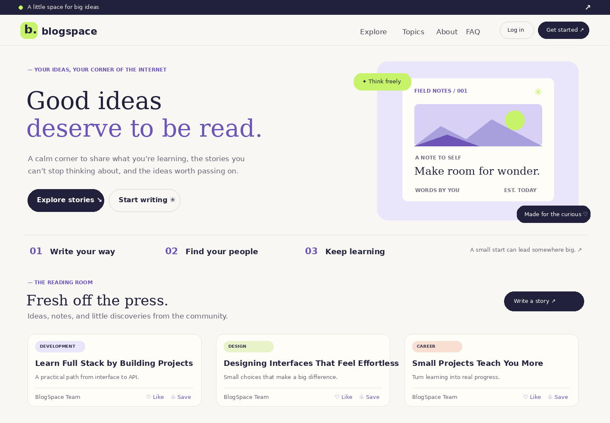

# BlogSpace — Full Stack Blog Platform

A portfolio project using HTML, CSS, Vanilla JavaScript, Node.js, and Express. No XAMPP or MySQL is needed.

## Features

- Like and unlike stories (account-based)
- Save/bookmark stories and filter your saved reading list
- Sort stories by newest, oldest, or most liked
- Estimated reading time and live story-result count
- Responsive professional UI
- Register, login, logout, and bcrypt password hashing
- Session-based authentication
- Create, read, update, delete your own blog posts
- Add and delete comments
- Search posts and filter by category
- REST API, validation, rate limiting, security headers
- JSON-file storage for simple local setup

## Screenshots

### Homepage and story feed



> The screenshot is stored in this repository, so GitHub can render it using the relative path above.

## Requirements
Install Node.js 18+ and npm.

## Run the project
1. Extract the ZIP and open the folder in VS Code.
2. Open a terminal in this folder.
3. Run `npm install`.
4. Optional: copy `.env.example` to `.env` and change `SESSION_SECRET`.
   - PowerShell: `Copy-Item .env.example .env`
   - macOS/Linux: `cp .env.example .env`
5. Run `npm start`.
6. Open http://localhost:3000.

For automatic restart while developing, run `npm run dev`.

## REST API
| Method | Endpoint | Login? | Purpose |
|---|---|---:|---|
| GET | `/api/health` | No | Health check |
| GET | `/api/auth/me` | No | Current session |
| POST | `/api/auth/register` | No | Create account |
| POST | `/api/auth/login` | No | Login |
| POST | `/api/auth/logout` | No | Logout |
| GET | `/api/posts?q=term&category=Design` | No | List/search/filter posts |
| GET | `/api/posts/:id` | No | One post and comments |
| POST | `/api/posts` | Yes | Create post |
| PUT | `/api/posts/:id` | Yes | Edit own post |
| DELETE | `/api/posts/:id` | Yes | Delete own post |
| POST | `/api/posts/:id/comments` | Yes | Add comment |
| DELETE | `/api/comments/:id` | Yes | Delete own comment or comment on own post |

Example post body:
```json
{ "title": "What I learned this week", "content": "Write at least twenty characters here...", "category": "Development" }
```

## Upload to GitHub
Create an empty repository on GitHub, then run these commands from the project folder:

```bash
git init
git add .
git status
git commit -m "Build BlogSpace full-stack blog platform"
git branch -M main
git remote add origin https://github.com/YOUR-USERNAME/YOUR-REPOSITORY.git
git push -u origin main
```

Replace the remote URL with your actual GitHub repository URL. `.env` and `node_modules/` are ignored. Never commit secrets or real user data.

If Git needs your identity:
```bash
git config --global user.name "Your Name"
git config --global user.email "you@example.com"
```

## Project structure
```text
BlogSpace-Full-Stack/
├── data/db.json
├── public/
│   ├── app.js
│   ├── index.html
│   └── styles.css
├── src/db.js
├── .env.example
├── .gitignore
├── package.json
├── server.js
└── README.md
```

## Important notes
This is an educational portfolio project, not production-ready. JSON storage and Express's default in-memory session store are appropriate for a simple local demo, but not for production or multiple server instances. For the next version, use PostgreSQL/MongoDB, a persistent session store, CSRF protection, automated tests, and deployment.

## Interview prep
Be prepared to explain:
- How frontend fetch calls communicate with Express REST endpoints
- Why passwords are hashed instead of stored in plain text
- How sessions track authenticated users
- How authorization prevents editing someone else's post
- Why input validation and HTML escaping matter
- Why JSON storage is simpler for a demo but unsuitable for production
